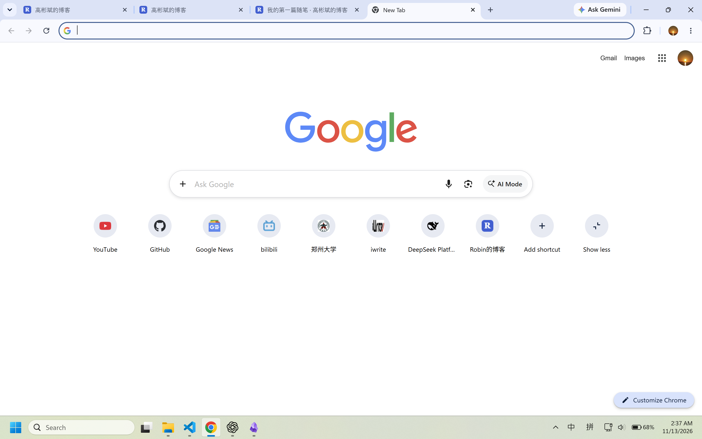
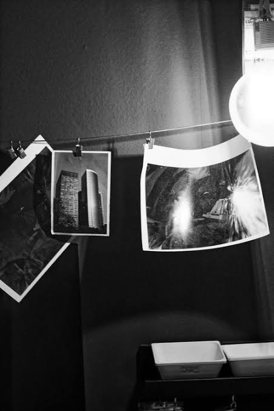

今天，我开始学习用 Markdown 写博客。

## 我已经完成了什么

- 创建 GitHub 仓库
- 开启 GitHub Pages
- 制作首页和文章页面
- 创建可复用的文章模板

## 今天理解的三个概念

**HTML**：描述网页的结构。

**CSS**：控制网页的外观。
123
**Markdown**：用简单的符号编写文章。

> 活在想象之外

接下来，我想持续记录自己的学习过程。

